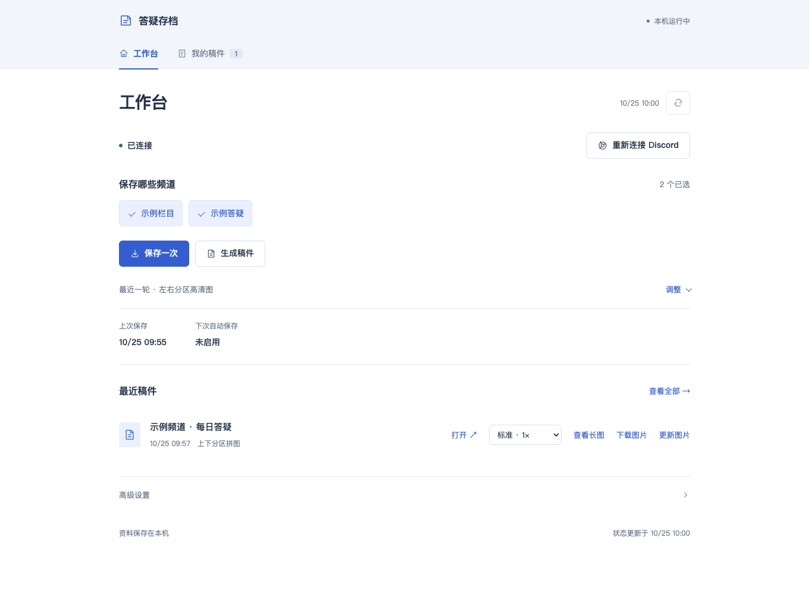
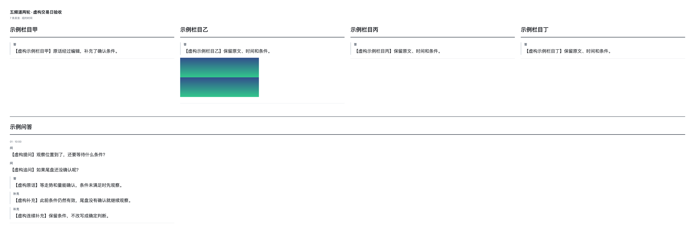

# Discord 本地归档与答疑整理

保存自己有权访问的 Discord 频道，围绕指定答疑人整理文字稿和长图。可以在 Mac 本地运行，也可以部署到 Ubuntu，通过私网工作台操作。

## 主要功能

- **保存消息与附件**：保留原文，后续增量更新。
- **整理答疑**：结合原问题、回复和后续补充，生成指定发言人的答疑稿。
- **生成长图**：支持多种版式、手机分栏、标准与 HiDPI PNG。
- **本地语音转写**：选装模型后，将已保存音频的转写加入稿件和图片。
- **定时出稿与推送**：到点保存消息、生成稿件和图片；可另存到目录，或推送到**邮箱、Telegram、Discord、微信 ClawBot**。
- **后台运行与私网访问**：支持自动启动、暂停和恢复任务；Ubuntu 独立处理，访问电脑无需一直开着。

消息、稿件和配置保存在实际运行应用的机器上；Mac 与 Ubuntu 的资料不自动同步。**推送默认关闭**，启用后会将生成的图片发送到你配置的收件邮箱或聊天平台。只保存自己有权查看的频道；账号自动读取仍受 Discord 平台规则约束。

## 效果预览

以下使用虚构频道和消息演示。点击图片可查看原图。

**工作台**

**导出长图**

安装与使用教程（Mac / Ubuntu / 手机访问）

## 选择使用方式

| 使用场景 | 下载文件 | 教程 |
| --- | --- | --- |
| Mac 本地运行 | `DiscordArchive-source.zip` | [Mac 安装与登录](docs/MAC.md) |
| 首次部署 Ubuntu | `DiscordArchive-source.zip`；连接时另需下面对应的访问客户端 | [Ubuntu 安装与首次连接](docs/LINUX_SETUP.md) |
| Mac 访问已有 Ubuntu | `login-assistant-mac.zip`（Mac 访问客户端） | [访问已有 Ubuntu](docs/ACCESS.md) |
| Windows 访问已有 Ubuntu | `login-assistant-windows.zip`（Windows 访问客户端） | [访问已有 Ubuntu](docs/ACCESS.md) |
| 手机访问已有工作台 | 无需下载项目；手机安装 Tailscale | [手机访问](docs/ACCESS.md#手机访问与-tailscale-ip) |

**Mac 本地直接登录，不需要扩展。Ubuntu 首次连接或重连时才用扩展；访问已连接的 Ubuntu 不重复绑定。** 访问 Ubuntu 的电脑不用安装完整项目或语音模型，图片推送在 Ubuntu 工作台里配置。

**首次保存会读取所选频道完整可见历史，选择稿件日期不会限制采集量。** 请先用一个消息少的频道，按 [首次使用教程](docs/USAGE.md#第一次采集出图)完成保存、出稿和下载。

后续按需配置：[每天自动出图与推送](docs/DELIVERY.md) · [本地语音转写](docs/USAGE.md#语音转写可选)。

已有安装更新前，先看 [保留资料更新的方法](docs/DELIVERY.md#已有安装如何更新)。旧分发包不会随当前源码自动更新；应使用包含新功能的完整源码或重新构建的分发包。

维护、排错与验收记录

## 维护与排错

- [日常管理、自启动与定时出稿](docs/OPERATIONS.md)
- [常见问题](docs/TROUBLESHOOTING.md)
- [Linux 维护、备用登录和 GPU 配置](docs/LINUX.md)
- [分发包构建与文件位置](docs/PACKAGING.md)
- [本轮可操作性与恢复验收](docs/RECOVERY_PORTS_ACCEPTANCE.md)
- [版本验证与平台限制](docs/FINAL_PACKAGE_ACCEPTANCE.md)
- [GitHub 上传与隐私检查](docs/GITHUB_PRIVACY.md)

基础采集与出图已在 Apple Silicon Mac、Ubuntu 22.04 x86_64 实测。新增四个推送渠道目前完成的是 **Mac 本机真实收件验收**，不代表 Ubuntu 已完成同一轮渠道测试；微信 ClawBot 也有会话有效期限制。详见 [推送验收范围](docs/DELIVERY.md#当前验收范围)。Windows 访问客户端已构建，尚待实机验证。

